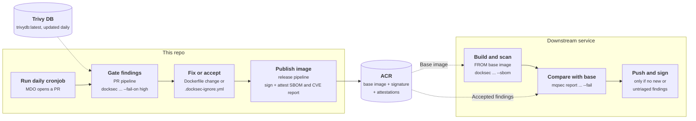
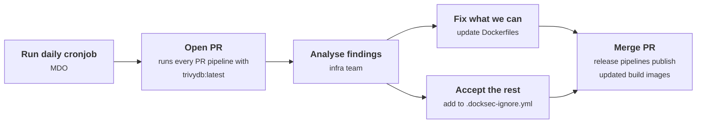
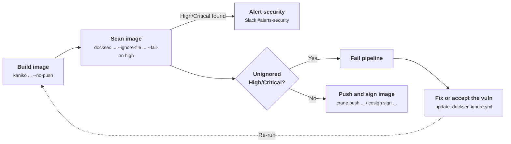
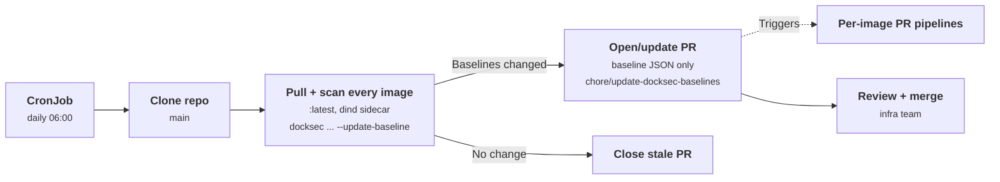
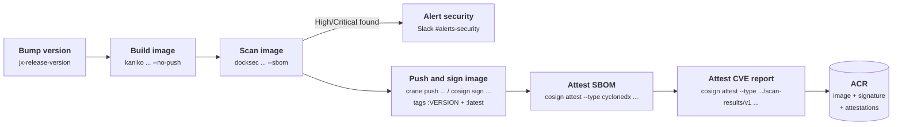
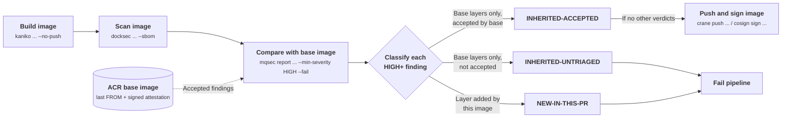

# Dockerfiles
Top-level container images used by MQube services.

## Adding a new container image
Say you want to add a new csharp image called `net-10`:
1. Create a folder within `dockerfiles/<category>/`, where the category best-describes the language or purpose of the image. The name of this sub-folder
will become the name of the generated image. Our `net-10` image would be created in `dockerfiles/csharp/net-10/`.
2. Regenerate the PR and release triggers in `.lighthouse/jenkins-x/triggers.yaml`:
```bash
./scripts/generate-triggers.sh
```
The `lint-pipelines` check fails if `triggers.yaml` is out of date, so don't edit it by hand.
3. Add an empty `.docksec-ignore.yml` (`ignores: []`) and generate the image's `.docksec-baseline.json`. Install `docksec`,
`trivy` and Docker locally, then build and scan the new image:
```bash
./scripts/create-baselines.sh --build --trivydb dockerfiles/csharp/net-10
```
Without a baseline, the PR gate fails on every existing High/Critical finding in the image.
4. Create a PR. The pipeline should run and build the new image

## Image Publication Diagrams

Note: The following is a work-in-progress, and may not reflect the current state of the pipelines.

### Overview of Vulnerability Management
This is an overview of how the components work together to manage security findings from this repo to the end-service.

**TL;DR**
1. A daily cronjob opens a PR so every image is re-scanned against the latest Trivy DB.
2. The PR pipeline fails on any new High/Critical finding. The infra team fixes what it can and accepts the rest in `.docksec-ignore.yml`.
3. Merging releases the images to ACR, each signed and carrying its SBOM and full CVE report as attestations.
4. Services built on these images compare their own findings against the base image's attestation, so they're only blocked by findings they introduced or that nobody has accepted.



### Updating CVE Findings
Trivy is used under-the-hood to scan images for vulnerabilities.
The trivy db is fetched from `ghcr.io/jenkins-x/trivydb:latest`, which is updated daily (starts at 6am UTC but takes ~6 hours to complete).
A cronjob runs daily to open a PR in this repo, which triggers all PR pipelines and updates the findings. 



### PR pipeline (`dockerfile-pr.yaml`)
Gates the build: any High/Critical finding not listed in the image's `.docksec-ignore.yml` fails the PR.



### Baseline refresh (`dockerfiles-baseline-updater` CronJob)
A CronJob in the `jx` namespace runs daily at 06:00 (Europe/London). It clones this repo and runs
`scripts/update-baselines-pr.sh`, which rescans every published `:latest` image against `trivydb:latest` with
`scripts/create-baselines.sh --trivydb --all` (`docksec ... --update-baseline`, no gate, no build, no push).
If any `.docksec-baseline.json` changed, it force-pushes only those files to the `chore/update-docksec-baselines`
branch and opens or updates a PR. The PR body lists the fingerprints added and removed for each image. The PR isn't
auto-merged: merging accepts the added findings, so review them first. The baseline changes trigger the per-image PR
pipelines, which gate against the new baselines. If nothing changed, any open baseline PR is closed as stale.

If an image fails to pull or scan, its baseline is left alone, it's listed in the PR body and the Job is marked failed.
The other images are still updated.

- **Chart:** `charts/dockerfiles-baseline-updater`, released to the OCI chart repo by `release.yaml` on merge to `main`.
- **Image:** `dockerfiles/tools/baseline-updater` (the docksec image plus git and jq).
- **Docker:** docksec needs a Docker daemon, which a privileged `docker:dind` native sidecar provides. Images are
  removed after each scan (`PRUNE=true`), so dind storage stays around `jobs` × the largest image.
- **Tuning:** set `jobs`, `resources`, `dind.resources` and `dockerStorage.sizeLimit` in the chart values.
- **Run it now:** `kubectl -n jx create job --from=cronjob/dockerfiles-baseline-updater baselines-manual-$(date +%s)`
- **Run it locally:** `DRY_RUN=true scripts/update-baselines-pr.sh` scans and prints the PR body without pushing.
  `scripts/create-baselines.sh` also refreshes a single image.



### Release pipeline (`dockerfile-release.yaml`)
Runs on merge to `main`. Scans without the ignore file and attaches the full CVE report and SBOM to the image as a signed attestations.



### Downstream service pipeline (`build-scan-push-mqsec.yaml`)
**Note: At time of writing, this has not yet been implemented....**

Services built on one of these images use the `build-scan-push` task from `mqube-pipeline-catalog`. `mqsec report` checks each finding against the base image's signed attestation, so a service is only blocked by findings it introduced or that nobody has accepted.



