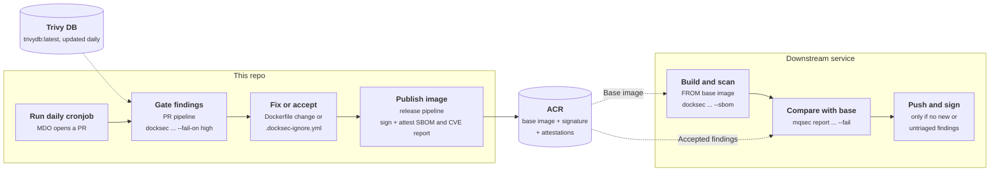
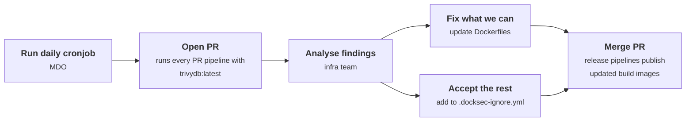
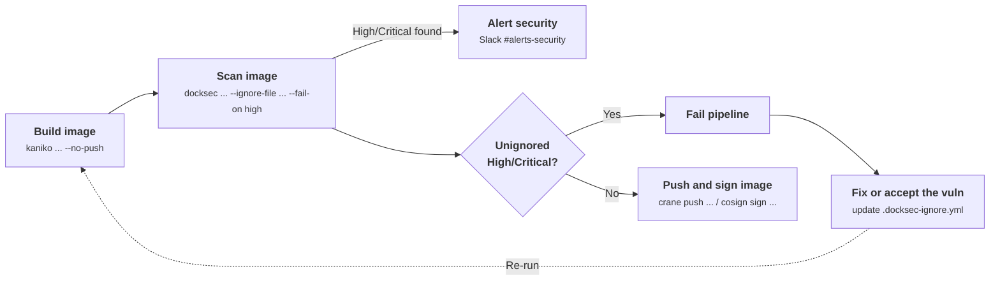
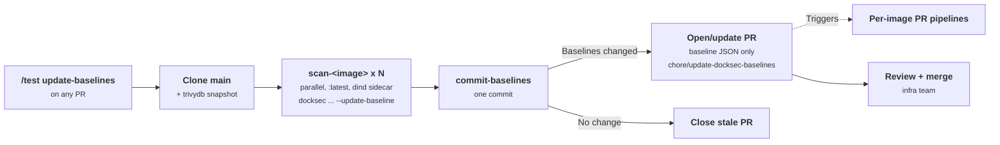
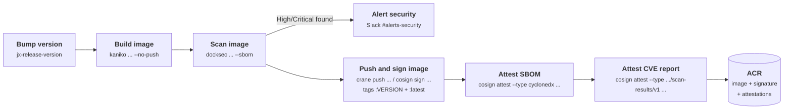
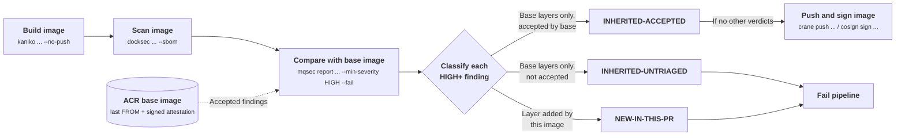

# Dockerfiles
Top-level container images used by MQube services.

## Adding a new container image
Say you want to add a new csharp image called `net-10`:
1. Create a folder within `dockerfiles/<category>/`, where the category best-describes the language or purpose of the image. The name of this sub-folder
will become the name of the generated image. Our `net-10` image would be created in `dockerfiles/csharp/net-10/`.
2. Regenerate the PR and release triggers in `.lighthouse/jenkins-x/triggers.yaml`:
```bash
./scripts/generate-triggers.sh
```
The `lint-pipelines` check fails if `triggers.yaml` is out of date, so don't edit it by hand.
3. Add an empty `.docksec-ignore.yml` (`ignores: []`) and generate the image's `.docksec-baseline.json`. Install `docksec`,
`trivy` and Docker locally, then build and scan the new image:
```bash
./scripts/create-baselines.sh --build --trivydb dockerfiles/csharp/net-10
```
Without a baseline, the PR gate fails on every existing High/Critical finding in the image.
4. Create a PR. The pipeline should run and build the new image

## Image Publication Diagrams

Note: The following is a work-in-progress, and may not reflect the current state of the pipelines.

### Overview of Vulnerability Management
This is an overview of how the components work together to manage security findings from this repo to the end-service.

**TL;DR**
1. A daily cronjob opens a PR so every image is re-scanned against the latest Trivy DB.
2. The PR pipeline fails on any new High/Critical finding. The infra team fixes what it can and accepts the rest in `.docksec-ignore.yml`.
3. Merging releases the images to ACR, each signed and carrying its SBOM and full CVE report as attestations.
4. Services built on these images compare their own findings against the base image's attestation, so they're only blocked by findings they introduced or that nobody has accepted.



### Updating CVE Findings
Trivy is used under-the-hood to scan images for vulnerabilities.
The trivy db is fetched from `ghcr.io/jenkins-x/trivydb:latest`, which is updated daily (starts at 6am UTC but takes ~6 hours to complete).
A cronjob runs daily to open a PR in this repo, which triggers all PR pipelines and updates the findings. 



### PR pipeline (`dockerfile-pr.yaml`)
Gates the build: any High/Critical finding not listed in the image's `.docksec-ignore.yml` fails the PR.



### Baseline refresh (`update-baselines.yaml`)
A manually triggered pipeline: comment `/test update-baselines` on any PR. Whichever PR it's run from, it always
refreshes `main`'s baselines. It's plain Tekton, one task per step, sharing a workspace:

1. **`git-clone`** clones `main` once and extracts one `trivydb:latest` snapshot, so every image is scanned against
   the same DB.
2. **`scan-<image>`**, one task per image, all in parallel, each with its own `docker:dind` sidecar, runs
   `scripts/create-baselines.sh --trivydb <image-dir>` against the published `:latest` image
   (`docksec ... --update-baseline`, no gate, no build, no push).
3. **`commit-baselines`** runs `scripts/update-baselines-pr.sh`: if any `.docksec-baseline.json` changed, it makes one
   commit with just those files, force-pushes it to `chore/update-docksec-baselines` and opens or updates a PR. If
   nothing changed, any open baseline PR is closed as stale.

The PR body lists the fingerprints added and removed for each image. The PR isn't auto-merged: merging accepts the
added findings, so review them first. The baseline changes trigger the per-image PR pipelines, which gate against the
new baselines.

If an image fails to pull or scan, its baseline is left alone, it's listed in the PR body and `commit-baselines` is
marked failed. The other images are still updated. If a scan *pod* dies (eviction, OOM), Tekton skips
`commit-baselines`, so rerun the pipeline.

- **Generated:** `scripts/generate-triggers.sh` writes `update-baselines.yaml` (one scan task per
  `dockerfiles/<group>/<image>`) and its trigger. `lint-pipelines` fails if either is stale.
- **Image:** the scan tasks use `dockerfiles/tools/baseline-updater` (the docksec image plus git and jq).
- **Run it locally:** `scripts/create-baselines.sh --trivydb --all && DRY_RUN=true scripts/update-baselines-pr.sh`
  rescans everything and prints the PR body without pushing. `scripts/create-baselines.sh` also refreshes a single image.



### Release pipeline (`dockerfile-release.yaml`)
Runs on merge to `main`. Scans without the ignore file and attaches the full CVE report and SBOM to the image as a signed attestations.



### Downstream service pipeline (`build-scan-push-mqsec.yaml`)
**Note: At time of writing, this has not yet been implemented....**

Services built on one of these images use the `build-scan-push` task from `mqube-pipeline-catalog`. `mqsec report` checks each finding against the base image's signed attestation, so a service is only blocked by findings it introduced or that nobody has accepted.



